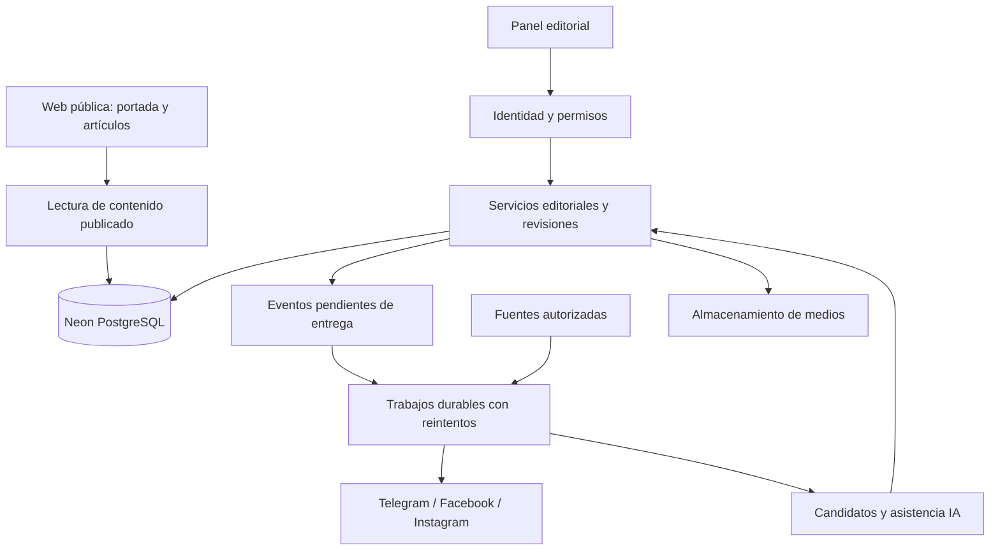

# AUDITORÍA NOTA PÚBLICA — FASE 0

Fecha: 14 de noviembre de 2026, zona America/Bogota. Alcance: diagnóstico técnico y funcional del repositorio y contraste puntual con producción. Este documento contiene recomendaciones; ninguna constituye una implementación autorizada.

## 1. Estado actual del proyecto

### Dictamen ejecutivo

NOTA PÚBLICA es una portada editorial estática con interacciones reales ejecutadas en el navegador y contenido de demostración. Cuenta con una función de servidor que verifica acceso a PostgreSQL en Neon. Todavía no es un CMS ni una plataforma editorial: no hay persistencia de artículos implementada, administración, autenticación, flujo de aprobaciones ni publicación multicanal.

El diseño, la identidad visual, las secciones y la infraestructura de GitHub/Vercel/Neon constituyen una base aprovechable. La evolución requiere incorporar modelo de datos, servicios editoriales, rutas de contenido y permisos. No hace falta rediseñar la landing; sí separar progresivamente su lógica y sustituir los datos de demostración por contenido publicado.

### Repositorio y versiones realmente inspeccionadas

- Raíz del repositorio de la aplicación: `nota-publica/`, dentro del workspace `frontnotapublica/`.
- Remoto `origin`: `https://github.com/emerbena/NOTA-PUBLICA.git`.
- Rama local: `main`. HEAD local: `0b24670`, incorporación del logo horizontal.
- Rama remota consultada durante la auditoría: `c0bb0b157023f5c882c80da2c7e94b4fb6ec8d60`, preparación de la conexión Neon.
- Cambios previos a esta auditoría sin commit: `dist/index.html`, `dist/styles.css`; archivo nuevo no versionado: `dist/favicon.png`.
- El commit del logo está solo en local respecto al remoto consultado. La cabecera compacta y la referencia al nuevo favicon son modificaciones adicionales del árbol de trabajo.
- La página pública consultada no incluye `nota-publica-horizontal.png` ni la referencia `favicon.png`. Por tanto, no se puede tratar la copia local como equivalente al sitio publicado.

Esta divergencia es un estado de trabajo pendiente, no una pérdida de código. Se conserva íntegramente; esta fase no realiza commit, push ni despliegue.

### Verificaciones realizadas

| Verificación | Resultado | Qué demuestra |
| --- | --- | --- |
| Lectura de los archivos de aplicación, configuración, lockfile y pruebas | Completada | Tecnologías y comportamiento definidos en el repositorio |
| `npm run check` | Correcto | Sintaxis de los cinco archivos incluidos en ese script; no es un lint ni un build |
| `npm test` | 4/4 pruebas correctas | Estados de la API, ocultación de errores y rechazo de POST |
| GET `https://www.notapublica.com/` | HTTP 200 | La portada pública responde |
| GET `https://www.notapublica.com/api/db-status` | HTTP 200, `{"ok":true,"database":"connected"}` | Una consulta `SELECT 1` funciona desde el despliegue |
| HEAD `https://notapublica.com/` | HTTP 308 hacia `https://www.notapublica.com/` | Redirección del dominio principal |
| GET `/robots.txt` y `/sitemap.xml` | HTTP 404 en ambos | Esos recursos no están disponibles en las rutas comprobadas |
| HEAD local `/favicon.png` | HTTP 200, `application/octet-stream` | El servidor local entrega la imagen sin MIME específico de PNG |
| Cabeceras de la portada pública | HSTS presente; CSP no observada | Evidencia limitada a la respuesta consultada |

### Límites explícitos

No se accedió al catálogo interno de Neon, roles SQL, tablas, datos, ramas, copias de seguridad ni credenciales. `SELECT 1` no demuestra que la base esté vacía, que existan tablas editoriales o que haya permiso de escritura. El repositorio no contiene esquemas ni migraciones de negocio.

No se inspeccionó la configuración privada actual de Vercel, GitHub, Capihost o Cloudflare, ni todas las variables por entorno. Las capturas anteriores muestran la integración y el dominio, pero no sustituyen una auditoría de esas cuentas. Tampoco se revisaron permisos de Meta o Telegram: no hay integración implementada en el código.

No se ejecutaron Lighthouse, pruebas de carga, pentest, análisis de vulnerabilidades del registro de paquetes ni una nueva sesión completa de navegación con lector de pantalla. La evaluación del frontend de esta fase es por inspección de HTML/CSS/JS y respuestas HTTP. Las comprobaciones visuales realizadas en turnos anteriores no se presentan como una nueva certificación responsive o WCAG.

## 2. Tecnologías identificadas

| Capa | Tecnología comprobada | Evidencia |
| --- | --- | --- |
| Frontend | HTML5 y JavaScript nativo; sin framework | `dist/index.html`, `dist/app.js` |
| Estilos | CSS propio, variables, Grid, Flexbox y media queries | `dist/styles.css` |
| Servidor | Node.js; proyecto ESM con `type: module` | `package.json`, `server.mjs` |
| Versión declarada | Node `24.x` | `package.json` y lockfile |
| Única dependencia directa | `@neondatabase/serverless`, rango `^1.2.1`, versión bloqueada `1.2.1` | `package.json`, `package-lock.json` |
| Dependencias de desarrollo | Ninguna declarada | `package.json` |
| Base de datos | Acceso a PostgreSQL en Neon mediante cliente HTTP | `lib/database.js` |
| API desplegable | Función Vercel con exportación `fetch` | `api/db-status.js` |
| Pruebas | `node:test` y `node:assert/strict` | `test/database-status.test.js` |
| Gestor reproducible de la aplicación | npm con lockfile v3 | `package-lock.json`, `vercel.json` |
| Imágenes editoriales | URLs de `images.unsplash.com` | HTML y función `image()` |
| Tipografías | Google Fonts: DM Sans y Manrope | `<link>` de fuentes y variables CSS |

No se encontraron React, Next.js, Vue, Angular, TypeScript, Tailwind, Bootstrap, Express, ORM, SDK de IA, librería de autenticación ni gestor de colas en la aplicación auditada. Next.js aparece como posible tecnología futura en este documento, no como tecnología actual.

### Despliegue y servicios

`vercel.json` declara `framework: null`, `buildCommand: ""`, `installCommand: "npm ci"` y `outputDirectory: "dist"`. No hay compilación del frontend; `dist/` es el código estático mantenido directamente. La carpeta raíz `api/` aporta la función de servidor. `server.mjs` sirve para desarrollo local y no es el proceso que aloja la portada en Vercel.

También existe `.openai/hosting.json`, con una identidad de Sites y publicación estática de `dist`. Es una configuración secundaria: por sí sola no ejecuta la función Neon. No se verificó el estado actual de ese alojamiento. La evolución del backend debe orientarse al despliegue Vercel ya utilizado por el dominio, evitando asumir paridad con Sites.

GitHub aloja el código. Vercel sirve el dominio público y la API. Neon responde a la prueba SQL. Capihost y Cloudflare aparecen en la configuración de dominio compartida por el usuario; no son dependencias de ejecución importadas por el código.

### Almacenamiento

- `stories` en `dist/app.js`: datos de demostración embebidos en el bundle, no una base persistente.
- `localStorage`, clave `np-saved`: guarda IDs de artículos en ese navegador; no sincroniza cuentas ni dispositivos.
- Neon: conexión operativa, sin lecturas/escrituras de contenido implementadas.
- No se encontró almacenamiento de archivos subidos, suscriptores, usuarios, votos o publicaciones sociales.

## 3. Estructura del repositorio

```text
nota-publica/                         ← raíz Git de la aplicación
├── .env.example                     ← DATABASE_URL vacía; no secreto
├── .gitignore                       ← excluye node_modules, .env*, .vercel
├── .openai/hosting.json             ← configuración estática de Sites
├── api/
│   └── db-status.js                 ← única función HTTP de la aplicación
├── dist/                            ← frontend servido directamente
│   ├── index.html                   ← única página HTML
│   ├── app.js                       ← datos, renderizado e interacciones
│   ├── styles.css                   ← sistema visual y responsive
│   ├── favicon.svg                  ← favicon anterior conservado
│   ├── favicon.png                  ← favicon nuevo, aún no versionado
│   └── assets/nota-publica-horizontal.png
├── lib/
│   ├── database.js                  ← cliente Neon y SELECT 1
│   └── database-status.js           ← respuestas y errores de la API
├── scripts/check-database.mjs       ← diagnóstico por consola
├── test/database-status.test.js     ← cuatro pruebas de API
├── package.json
├── package-lock.json
├── README.md
├── server.mjs                       ← servidor HTTP local
└── vercel.json
```

`node_modules/` existe localmente y está ignorado. En el directorio superior hay otro `package.json` llamado `frontnotapublica`, un `pnpm-lock.yaml`, un script `preview-check.mjs`, capturas, un archivo de despliegue y un perfil de navegador. No pertenecen al inventario Git de `nota-publica`; no deben confundirse con dependencias, pruebas CI o artefactos de producción de esta aplicación. El script de prueba del paquete superior es un placeholder que termina con error.

### Enrutamiento

No existe router frontend. Solo hay la portada `/`, enlaces de fragmento como `#historias`, `#opinion` y `#boletin`, y el enlace `./` al inicio. Las categorías son botones que filtran la lista en memoria. Los artículos se abren en un `<dialog>`; no generan URL, historial de navegación ni página independiente.

La única ruta de API definida es `/api/db-status`. El servidor local reconoce esa ruta explícitamente y sirve el resto desde `dist/`, con fallback 404, no con un router de SPA.

## 4. Funcionalidades existentes

La palabra «funciona» en esta tabla describe el comportamiento implementado en el código; no implica un servicio editorial conectado ni una prueba de navegador nueva en esta fase.

| Elemento | Comportamiento implementado | Persistencia o límite |
| --- | --- | --- |
| Encabezado | Marca enlazada al inicio, fecha en zona America/Bogota, botón de búsqueda y enlace al boletín | Fecha del reloj del dispositivo; no es fecha editorial de una edición |
| Navegación | Inicio y filtros Actualidad, Política, Economía, Cultura, Tecnología y Planeta | Sin páginas de categoría ni URLs compartibles |
| En conversación | Botones que establecen una consulta de búsqueda | Temas fijos, no tendencias medidas |
| Portada | Noticia principal, imagen, resumen y apertura del diálogo | Selección fija escrita en HTML |
| En el radar | Tres titulares con imagen y lectura modal | Orden y selección fijos |
| Historias | `render()` muestra tres tarjetas inicialmente; «Ver todas» muestra siete noticias | No incluye la columna de Opinión en esa lista |
| Categorías | Filtrado por coincidencia de categoría | Misma colección embebida; sin taxonomía persistente |
| Buscador | Busca en título, descripción y categoría; normaliza mayúsculas y acentos; muestra estado vacío | No busca en cuerpos completos ni en internet; sin índice o backend |
| Lectura | `openStory()` rellena diálogo con texto, imagen y aviso demo | Ocho entradas totales en `stories`: siete noticias y una columna |
| Guardados | Alterna IDs, muestra notificación, usa `localStorage`; tolera almacenamiento no disponible | Solo navegador; no hay página de «mis guardados» |
| Otras miradas | Cita editorial y apertura de columna | No hay perfiles de columnistas |
| Boletín | Validación nativa de email y consentimiento; muestra aviso y reinicia formulario | No crea suscripción ni realiza envío de red |
| Footer | Enlaces al boletín y diálogos de presentación, principios y privacidad | Textos fijos de demostración |
| API Neon | GET ejecuta `SELECT 1`, timeout de 8 segundos; 200 o 503; otros métodos 405 | Solo disponibilidad, sin operaciones editoriales |

### Responsive y accesibilidad presentes

CSS incluye ajustes en 1500, 1100, 800 y 560 px. En tablet la portada pasa a una columna, la barra lateral se reorganiza y la navegación permite desplazamiento horizontal. En móvil las tarjetas y el boletín pasan a una columna. En el árbol local la cabecera tiene mínimos de 84/76/66 px según ancho, y el logo móvil usa `clamp()`.

Hay `lang="es"`, viewport, landmarks semánticos, enlace para saltar al contenido, textos alternativos, labels, `aria-expanded`, `aria-pressed`, estados anunciados con `role="status"`, foco visible y `<dialog>` nativo. Existe una regla CSS de movimiento reducido.

Esto es una buena base, pero quedan por medir contraste, zoom al 200–400 %, navegación completa por teclado, anuncios del diálogo y tamaños táctiles. Algunos textos tienen 9–10 px y botones de guardado 32 px. JavaScript solicita desplazamientos suaves explícitos incluso cuando CSS reduce el movimiento; conviene unificar ese comportamiento en una fase posterior.

## 5. Funcionalidades simuladas

- Noticias, autores genéricos y tiempos de lectura son valores escritos manualmente. No son noticias extraídas o verificadas automáticamente.
- «Lo que importa hoy», portada y radar no se actualizan por calendario ni por consulta a Neon.
- El boletín no almacena correo, no gestiona bajas y no envía mensajes. El consentimiento del formulario tampoco se conserva.
- Los textos «Quiénes somos», principios y privacidad describen el prototipo, no una operación editorial plenamente implementada.
- Las categorías y la búsqueda son interacciones reales sobre datos ficticios, no un CMS o motor de noticias.
- Guardar una noticia no implica iniciar sesión ni guardarla en Neon.
- No existen administración, autenticación, roles, aprobaciones, agentes, fuentes automáticas, Telegram, Facebook/Instagram, rankings, encuestas, premios o calendario editorial en el código auditado.

## 6. Componentes reutilizables

No hay componentes de framework ni biblioteca de UI. Sí existen bloques HTML/CSS y funciones que pueden convertirse en componentes conservando el aspecto actual.

| Recurso actual | Reutilización propuesta |
| --- | --- |
| Variables de `:root`, paleta y tipografías | Tokens visuales compartidos entre portada y administración, manteniendo estilos públicos |
| `.container`, Grid/Flexbox y breakpoints | Layout editorial y reglas responsive |
| Header, navegación y footer | Plantilla compartida de páginas públicas |
| `.hero-story`, `.radar-story`, `.story-card` | Variantes de tarjeta alimentadas por el mismo modelo de artículo |
| Diálogo, estados vacíos, toast y botones | Elementos de interacción; el diálogo puede seguir como vista rápida |
| `normalize()` | Utilidad de búsqueda local; no reemplaza búsqueda SQL |
| Eventos `data-story`, `data-category`, `data-save` | Referencia del comportamiento que debe conservarse durante la transición |
| `getDatabase()` | Adaptador de conexión exclusivo del servidor |
| `createDatabaseStatusHandler()` y pruebas | Patrón de manejo de errores y prueba con dependencias sustituibles |
| Configuración GitHub/Vercel/Neon | Infraestructura base que evita mover el alojamiento o la base sin necesidad |
| Logo horizontal y favicon entregados | Activos de marca; conservar los originales y optimizar derivados después |

## 7. Problemas detectados

Prioridad alta significa resolver antes de introducir contenido externo, escrituras o publicación editorial; no implica que exista un incidente activo.

| ID / prioridad | Hallazgo y evidencia | Implicación / acción futura |
| --- | --- | --- |
| P01 — Alta para el CMS | `render()`, `openStory()` y `openInfo()` interpolan valores en `innerHTML` | Con textos constantes no se demuestra explotación actual. Con contenido de usuarios, feeds o IA sería un punto de XSS; usar escape por contexto y sanitización del contenido enriquecido |
| P02 — Alta para el CMS | No hay autenticación, autorización ni endpoints de escritura | Implementar controles de servidor antes de cualquier panel o publicación; ocultar botones no protege datos |
| P03 — Alta para operación editorial | Sin esquemas, migraciones, revisiones ni transacciones de negocio | La conexión Neon no equivale a almacenamiento editorial listo; definir modelo y migraciones verificables |
| P04 — Alta para SEO editorial | Titulares enlazados mediante botones y artículos solo en diálogo | Cada noticia necesita una URL estable y HTML accesible sin interacción, además de enlaces reales |
| P05 — Media | Metadatos solo globales; sin canonical, Open Graph, Twitter Cards o JSON-LD de noticias en el HTML | Compartición social e indexación editorial incompletas; crear metadatos por artículo |
| P06 — Media | `robots.txt` y `sitemap.xml` ausentes localmente y 404 públicamente | Añadirlos al incorporar rutas; su ausencia no significa que Google no pueda indexar la portada |
| P07 — Media | Historias de portada/radar duplicadas entre HTML y colección JS | Un titular puede cambiar en una vista y no en otra; derivar ambas del mismo registro |
| P08 — Media | Un único `app.js` mezcla contenido, selección DOM, estado y eventos | Aumenta el acoplamiento; separar datos, presentación y servicios antes de crecer |
| P09 — Media | CSS prácticamente concentrado en líneas extensas, reglas repetidas y overrides de marca | Difícil mantenimiento; conservar diseño y ordenar por componentes. Quedan selectores de la marca tipográfica anterior |
| P10 — Media | Sin paginación; `render()` reconstruye todas las tarjetas visibles por cada entrada de búsqueda | Adecuado para siete noticias, inadecuado para un catálogo grande; consultar/paginar en servidor |
| P11 — Media | Cuerpos completos dentro del JS y sin hidratación de datos desde API | Crece el archivo con cada noticia y se expone todo lo incluido; nunca incorporar borradores privados a este bundle |
| P12 — Media | Fotos remotas sin `srcset`/`sizes`; fuentes externas | Dependencia de disponibilidad externa y transferencia mejorable; no se midieron LCP, CLS o INP |
| P13 — Media/baja | Logo PNG local de 441.067 bytes; favicon PNG de 147.731 bytes | Grandes para su presentación final; generar derivados adecuados más adelante, sin alterar originales ahora |
| P14 — Media | API pública sin limitación de frecuencia y con `Cache-Control: no-store` | Cada GET puede activar consulta/compute. No filtra secretos; valorar acceso operativo limitado o limitación de solicitudes |
| P15 — Media | No CSP en configuración ni en la respuesta pública consultada | Definir una política compatible con imágenes/fuentes y futuras integraciones; no equivale por sí sola a XSS confirmado |
| P16 — Media | Errores SQL ocultos correctamente, pero sin observabilidad estructurada en el código | Diagnóstico limitado; registrar códigos seguros, correlación y alertas sin URLs ni contraseñas |
| P17 — Media | Cuatro pruebas de API; no pruebas frontend versionadas ni workflow CI | Un despliegue no acredita regresiones visuales, SEO o permisos. La prueba de éxito usa un sustituto; la consulta HTTP real se comprobó aparte |
| P18 — Media | Estado local diferente de remoto y producción | Riesgo de auditar/probar una versión y publicar otra. Acordar qué cambios pasan a producción y mantener una línea base |
| P19 — Baja actual | Servidor local no incluye MIME PNG y convierte todas las excepciones del bloque en 404 | Confirmado `application/octet-stream`; mejorar mapa MIME y clasificación de errores antes de ampliar este servidor |
| P20 — Media de mantenimiento | Dos manifiestos de alojamiento y un paquete distinto en la carpeta superior | Documentar la raíz y el destino oficiales; evitar instalar/ejecutar en la carpeta equivocada o desplegar solo estáticos cuando se requiera API |

### Dependencias y seguridad actuales

La única dependencia instalada declarada es pertinente para Neon; no se detectaron dependencias innecesarias en `package.json`. El lockfile solo registra ese paquete además del proyecto. No se ha ejecutado una auditoría de advisories, por lo que no se afirma ausencia de vulnerabilidades.

Puntos positivos: `.env*` ignorados con excepción del ejemplo vacío; código de base fuera de `dist`; respuesta de estado sin credenciales; consulta de diagnóstico constante; timeout; HTTPS y HSTS observados. El código frontend auditado no contiene la URL de conexión. No se hizo un análisis forense de secretos en todo el historial Git ni se leyeron secretos de servicios.

## 8. Arquitectura recomendada

### Decisión principal: monolito modular con evolución gradual

Conservar Vercel, Neon y la identidad visual. Crear módulos de dominio con interfaces claras dentro del mismo proyecto, no microservicios desde el inicio. Separar el sitio público, las operaciones administrativas y los trabajos asíncronos. La base de datos debe ser la fuente de verdad; ni los feeds externos ni las respuestas de IA deben publicar directamente.



El diagrama representa una propuesta, no conexiones actualmente implementadas.

### Tecnologías propuestas y criterio

| Elemento | Recomendación | Motivo y coste de adopción |
| --- | --- | --- |
| Portal y panel | Next.js App Router + TypeScript, incorporados por fases | Ofrece rutas, composición de UI y separación servidor/cliente. Requiere migración de plantillas y eventos; no está instalado y no es una actualización automática del HTML |
| Estilos | Conservar CSS y tokens; modularizar gradualmente | Evita un rediseño y una migración a Tailwind sin necesidad |
| Base | Mantener Neon PostgreSQL | Ya existe acceso funcionando; relaciones, revisiones y transacciones encajan con contenido editorial |
| Modelo/migraciones | Drizzle ORM + Drizzle Kit con SQL versionado | Compatible con Neon; permite contratos TypeScript y migraciones revisables. No aplicar cambios de esquema automáticos desde una petición pública |
| Identidad | Proveedor de autenticación mantenido compatible con OIDC o integración gestionada, con roles propios en PostgreSQL | Evita inventar manejo de contraseñas. Elegir proveedor tras comprobar costos, MFA, región y conexión de cuentas; no asumir que Neon Auth está activado |
| Búsqueda | Full Text Search de PostgreSQL inicialmente | Aprovecha la base existente; evaluar motor especializado solo con necesidades/volumen medidos |
| Medios | Almacenamiento de objetos y CDN; PostgreSQL conserva metadatos | No guardar archivos binarios grandes en filas ni depender del disco efímero de funciones |
| Automatización | Cola o motor de trabajos durables con estado, idempotencia y reintentos | Programaciones, extracción y redes sociales no deben depender de mantener abierta una petición HTTP |
| Validación | Esquemas de entrada compartidos, por ejemplo Zod al adoptar TypeScript | Validación real en servidor, además de formularios; dependencia futura, no presente |
| IA y canales | Adaptadores de proveedor detrás de servicios propios | Permite cambiar modelo/API y conservar controles, revisiones y trazabilidad |

Next.js soporta componentes de servidor y cliente y rutas de aplicación: [documentación oficial](https://nextjs.org/docs/app/getting-started/server-and-client-components). Es una recomendación por el alcance del portal, no un requisito para seguir usando Neon. La alternativa de menor cambio inmediato es continuar con HTML y Vercel Functions mientras se implementa el dominio editorial; mantener todo el portal futuro como un solo archivo JS no es la recomendación final.

Drizzle documenta su integración con Neon y migraciones: [guía oficial](https://orm.drizzle.team/docs/tutorials/drizzle-with-neon). PostgreSQL incluye búsqueda de texto y ranking de resultados: [documentación oficial](https://www.postgresql.org/docs/current/textsearch.html). Esto no confirma qué versión concreta de PostgreSQL usa la instancia del usuario.

### Transición que conserva lo existente

1. Fijar una línea base visual y funcional, resolver por autorización la divergencia de marca y conservar originales.
2. Diseñar módulos y datos sin alterar la portada. Mantener `getDatabase()` detrás de una capa de repositorios.
3. Introducir administración, identidad y CMS en rutas nuevas; mantener la portada existente mientras se valida el flujo editorial.
4. Crear páginas de artículos y categorías con HTML renderizado en servidor, URLs estables y metadatos. Trasladar los bloques actuales a componentes preservando clases, paleta, composición y breakpoints.
5. Reemplazar la colección JS por lecturas de contenido publicado y conectar portada/radar a selecciones editoriales persistidas.
6. Migrar el punto de entrada de Vercel de forma planificada. Si se adopta Next.js, la configuración estática `outputDirectory: dist` y el build vacío dejarán de ser adecuados; ese cambio se haría solo en su fase aprobada.

No se promete reutilizar todo el JavaScript sin cambios: eventos DOM globales y `innerHTML` necesitan adaptación. La reutilización principal es visual, de activos, reglas funcionales, conexión y alojamiento. No requiere tirar la landing ni reconstruir su diseño.

### Modelo editorial conceptual, todavía no implementado

| Dominio | Entidades previstas y reglas |
| --- | --- |
| Identidad | Usuarios internos, roles, permisos y sesiones/referencias del proveedor. Autor editorial separado del usuario que inicia sesión |
| Noticias | Artículos, revisiones inmutables, autores, categorías, etiquetas, medios y selecciones de portada. Slug único, estado, fechas y atribución |
| Aprobaciones | Solicitudes, decisiones, comentarios y registro de auditoría; cada aprobación referencia una revisión exacta |
| Calendario | Encargos, responsables, fechas límite y publicaciones programadas; almacenar instantes en UTC y mostrar America/Bogota |
| Fuentes | Fuentes autorizadas, URL original, fecha, hash, candidato importado y procedencia |
| IA | Ejecuciones, modelo, versión de instrucciones, fuentes usadas, salida propuesta, coste/estado y revisión humana |
| Canales | Cuentas conectadas, referencia segura a secretos, variantes por canal, trabajos, intentos e IDs de publicaciones remotas |
| Audiencia | Suscriptores, consentimientos y bajas; favoritos por usuario si se incorpora acceso de lectores |
| Encuestas | Encuesta, opciones, ventana temporal y votos; restricciones y estrategia contra duplicación/abuso |
| Rankings | Criterios, periodo, datos agregados y versión del cálculo. Definir si son editoriales, de popularidad o de resultados |
| Premios | Ediciones, categorías, nominaciones, candidatos, jurados, decisiones y resultados. Separar voto público de evaluación editorial |

Flujo propuesto: **borrador → en revisión → aprobado → programado/publicado → archivado**. Rechazos devuelven a edición. Modificar una revisión aprobada debe invalidar su aprobación o crear otra pendiente; no publicar silenciosamente un texto distinto al revisado. Permisos mínimos sugeridos: administrador, editor, redactor y publicador; lectores y jurados se incorporan solo cuando sus módulos lo requieran.

La publicación debe registrar en una misma transacción el cambio editorial y un evento pendiente de entrega (patrón outbox). Los procesos de canales consumen ese evento con claves de idempotencia y estados por destino. Un fallo en Instagram no debe revertir una noticia ya publicada en la web ni duplicar el mensaje de Telegram. El calendario debe disparar trabajos pendientes almacenados, no temporizadores dentro del navegador.

### IA, búsqueda automática y multicanal

La ingestión de noticias debe obtener candidatos desde feeds/APIs permitidos, con deduplicación, referencias y límites. No convertir contenido externo directamente en artículos publicados ni asumir derechos de reutilización. La IA propone resúmenes, clasificaciones y borradores; las fuentes se tratan como datos no confiables, sin capacidad de ejecutar herramientas o alterar permisos. Separar el permiso de redactar del de aprobar/publicar y registrar qué intervención fue automática.

Telegram requiere un bot y destinos autorizados; validar webhooks y deduplicar eventos. Su API permite un secreto de verificación de webhook: [documentación oficial](https://core.telegram.org/bots/api).

Facebook e Instagram requieren estudiar las cuentas y el flujo de acceso concreto, permisos de publicación, revisión de aplicación cuando corresponda, expiración de tokens y formatos admitidos. No se presupone que la cuenta del usuario pueda publicar por API. Meta dispone de distintos flujos de Instagram; la vinculación obligatoria a una página Facebook depende del flujo, por lo que no debe generalizarse: [referencia oficial](https://developers.facebook.com/docs/instagram/platform/instagram-api/changelog/). Los valores definitivos de permisos y versiones se verificarán al implementar los conectores.

Los límites de duración y tamaño de Vercel Functions deben verificarse para el plan real antes de decidir extracción de fuentes o generación multimedia: [límites oficiales](https://vercel.com/docs/functions/limitations). No se recomienda ejecutar procesos largos sin persistencia y reintentos dentro del endpoint público.

## 9. Riesgos técnicos

| Riesgo | Impacto | Medida propuesta / evidencia pendiente |
| --- | --- | --- |
| Confundir conexión SQL con plataforma terminada | Alto | Definir criterios de éxito por módulo; hoy solo está acreditado SELECT 1 |
| Publicar contenido externo mediante `innerHTML` | Alto al conectar CMS/IA | Escape, sanitización, validación de URLs y política de contenido |
| Escrituras sin roles o aprobación de revisión | Alto | Autorización en cada operación y trazabilidad; no basta la UI |
| Mezclar bases o ramas de prueba con producción | Alto | Verificar variables y ramas reales antes de migraciones; no se inspeccionaron desde esta auditoría |
| Borradores filtrados al bundle o a caché pública | Alto | Consultas públicas limitadas a revisiones publicadas; caché y autenticación separadas |
| Publicaciones duplicadas o fuera de horario | Alto | Outbox, reintentos, idempotencia, bloqueo de trabajos y control de zona horaria |
| Contenido falso o instrucciones maliciosas en fuentes/IA | Alto | Procedencia, revisión humana, permisos mínimos y separación entre datos e instrucciones |
| Dependencia de imágenes, fuentes y APIs externas | Medio | Inventario de derechos/activos, fallback, CDN, monitorización y adaptadores |
| Costes de compute, IA o endpoint de estado público | Medio | Cuotas, alertas y límites medidos; no se auditaron planes ni facturación |
| Falta de restauración verificada | Alto al guardar datos reales | Comprobar recuperación/retención y ensayar restauración en entorno separado; no asumir backups por usar Neon |
| Permisos/tokens de redes sociales no disponibles | Medio/alto para multicanal | Validar cuentas y permisos antes de comprometer fechas de entrega |
| Divergencia entre local, GitHub, Vercel y Sites | Medio | Definir destino oficial, rama de entrega y procedimiento de rollback |
| Encuestas/rankings manipulables | Alto para confianza editorial | Reglas transparentes, unicidad cuando aplique, límites y auditoría; IP sola no identifica una persona |
| Regresiones responsive o de accesibilidad | Medio | Pruebas visuales y teclado sobre una matriz acordada, conservando el diseño |

No se afirma que haya ocurrido ninguno de estos incidentes. Algunos riesgos son actuales y otros aparecen al introducir las capacidades solicitadas.

## 10. Plan de desarrollo por fases

Cada fase requiere autorización antes de comenzar. El orden prioriza datos y control editorial antes de automatización.

| Fase | Entregable futuro | Dependencias | Criterio de aceptación |
| --- | --- | --- | --- |
| 0 — Auditoría | Este documento y evidencias | Repositorio y lectura pública | Diagnóstico completo, limitaciones declaradas y aplicación intacta |
| 1 — Base técnica | Línea base de diseño, raíz oficial, separación de módulos, estrategia de migración, entornos y CI | Aprobación de arquitectura | Checks reproducibles, diferencias local/producción resueltas por decisión explícita, ninguna regresión visual |
| 2 — Datos e identidad | Modelo SQL versionado, autenticación interna, roles, auditoría y medios | Fase 1; acceso de gestión a Neon | Migraciones probadas fuera de producción, permisos negativos verificados y restauración definida |
| 3 — CMS y portal | Crear/editar noticias, autores, categorías, revisiones, URLs, portada alimentada con publicaciones y SEO | Fase 2 | Borradores inaccesibles públicamente; artículos persistentes y enlazables; diseño conservado |
| 4 — Aprobaciones y calendario | Centro editorial, comentarios, decisiones por revisión y agenda | Fase 3 | Ningún cambio no aprobado se publica; programación recuperable tras fallos |
| 5 — Fuentes e IA asistida | Ingestión autorizada, deduplicación, propuestas y registro de ejecuciones | Fase 4 | Cada propuesta tiene procedencia y revisión; límites de coste y prohibición de autopublicación no autorizada |
| 6 — Multicanal | Telegram, Facebook e Instagram mediante adaptadores | Fases 4–5 según origen; permisos externos | Entrega por canal trazable, reintentos sin duplicados, credenciales protegidas |
| 7 — Audiencia | Boletín real, encuestas y rankings | Fases 2–3; reglas de negocio definidas | Consentimiento/baja operativos, votos resistentes a abuso y criterios visibles |
| 8 — Premios | Ediciones, nominaciones, jurados, votación y resultados | Identidad, auditoría y mecanismos de participación | Reglas por edición, separación de funciones y resultados reproducibles |
| Transversal — Operación | Observabilidad, rendimiento, accesibilidad, backups, recuperación y revisión de costos | Todas | Evidencias periódicas, alertas útiles y pruebas de recuperación |

### Decisiones pendientes antes de implementar

Confirmar adopción gradual de Next.js/TypeScript frente a mantener temporalmente la portada estática; proveedor de identidad; roles y quién puede aprobar; tipos de noticias y medios; primeras fuentes autorizadas; cuentas sociales disponibles; definición de rankings/premios; reglas de encuestas; volumen esperado y presupuesto operativo. No se necesitan respuestas para cerrar esta auditoría, pero sí para diseñar las siguientes fases sin inventar requisitos.

### Cierre de la fase

Auditoría completa dentro del alcance disponible. Se ejecutaron lecturas, verificaciones de sintaxis, las pruebas existentes y consultas HTTP de diagnóstico. No se instalaron dependencias, alteraron configuraciones, eliminaron archivos, modificaron diseños, crearon tablas ni desplegaron cambios. El único archivo creado por esta fase es `AUDITORIA_NOTA_PUBLICA.md`; los cambios locales anteriores se conservaron. La implementación queda pendiente de autorización expresa.
